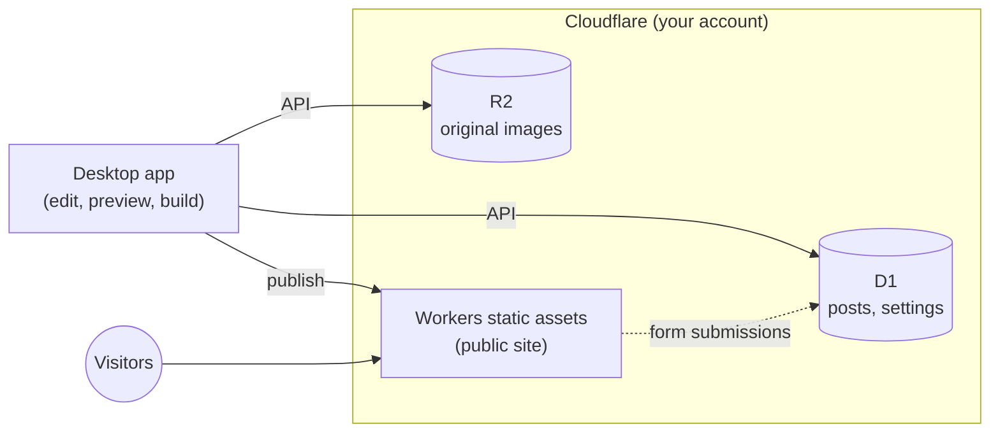

# Zero Web Admin CMS

English | [日本語](README_ja.md)


A CMS with no admin screen on the public site at all. ZWA CMS for short.

You edit in a desktop app and publish a static site to Cloudflare. The public site has no login page and no database connection, so there is nothing to attack. It is fast, and running costs are expected to stay within Cloudflare's free plan.

> [!NOTE]
> Under development. Specifications and data formats may change without notice.
> The app's interface is in Japanese only for now.

## Features

- **The admin screen is an app on your PC**: a desktop app for Windows, macOS and Linux. No server and no local development environment (such as Node.js) is needed. Closing the window keeps it in the system tray with the preview server running (quit from the tray menu)
- **Everything runs on Cloudflare**: posts are stored in D1, images and other media in R2, and the site is served as Workers static assets. The app creates the resources it needs
- **An easy editor**: a WYSIWYG editor that saves Markdown. Typing Markdown syntax such as `# ` or `- ` formats as you type, and pasted Markdown text is formatted too. Images can be pasted or dragged in
- **Instant preview**: the site is generated on your PC and opened in your browser. It updates on save and shows drafts too
- **Site search that handles Japanese**: a search index ([Pagefind](https://pagefind.app/)) is built at build time. Search runs in the browser, with nothing on the server. It can be turned off in Site info to make the site lighter
- **Multiple sites**: switch between sites in one app. Another PC can connect to the same site
- **SEO basics**: sitemap.xml, RSS (feed.xml), canonical URLs and security headers
- **Contact forms (optional)**: put a form on a page. Submissions are stored in the site's D1 and read in the app. Spam is blocked with Cloudflare Turnstile

## How it works



- The app reads and writes D1 and R2 directly through the Cloudflare API. There is no server of ours in between
- To publish, the app generates the whole site as static files and uploads them to Workers. Later publishes send only the files that changed
- The public site is static files. The only code running on the server stores contact form submissions in D1 (only when forms are enabled). There are no comments

### Supported platform

ZWA CMS is for Cloudflare only. Storage (D1, R2), publishing (Workers) and contact forms (Workers, Turnstile) all assume Cloudflare. Publishing to AWS or other services is not supported and is not planned.

The files `zwa build` generates are an ordinary static site, so you can host them elsewhere at your own risk. Contact forms will not work there, since nothing receives the submissions.

## Requirements

- A Cloudflare account (the free plan works)
  - R2 must be enabled once per account in the dashboard
  - If your workers.dev subdomain is not set up yet, open "Workers & Pages" in the dashboard once to set it
- A Cloudflare **user API token** (below)

### Creating the API token

The app uses a **user API token**, not an account API token.

1. Open **My Profile → API Tokens** from the icon at the top right of the Cloudflare dashboard
2. Choose **Create Token** → **Create Custom Token**
3. Add these permissions

   | Type | Item | Permission |
   |---|---|---|
   | Account | D1 | Edit |
   | Account | Workers R2 Storage | Edit |
   | Account | Workers Scripts | Edit |

   For contact forms, also add `Account` / `Turnstile` / `Edit`. You can add it to the token later (the app tells you if it is missing when you enable forms)

4. Under **Account Resources**, pick the account to use and create the token
5. Paste the token into the app

The token is kept in the OS keychain (Credential Manager on Windows, Keychain on macOS, and so on), never in a plain-text settings file.

> Connecting with a browser sign-in (OAuth) is planned.

## Usage

1. Start the app, paste the API token and connect to Cloudflare
2. In "サイトを追加" (Add site), enter a site name and a site ID
   - The site ID uses lowercase letters, digits and hyphens. It names the Cloudflare resources (`zwa-<site ID>` and so on) and cannot be changed later
   - A D1 database and an R2 bucket are created
3. Edit posts, pages, categories, tags and media (featured images and authors too; authors are registered in Site info)
4. "プレビュー" (Preview) at the bottom left opens the site in your browser
5. "サイトに公開" (Publish site) publishes it to Cloudflare
   - It is served at `https://zwa-<site ID>.<your account subdomain>.workers.dev/`
   - Only posts and pages marked as published are included
6. When you no longer need a site, Site info → Cloudflare → "サイトを削除" (Delete site) deletes the Cloudflare resources the app made for it (Worker, R2, D1 and so on). This cannot be undone

### Syntax highlighting

Code blocks with a language name (such as ```` ```rust ````) are highlighted on the public site and in the editor. The site is colored at build time, so no JavaScript runs in visitors' browsers.

| Language | Names |
|---|---|
| Bash, shell | `bash` `sh` `shell` `zsh` `console` |
| C / C++ / C# | `c` / `cpp` `c++` / `csharp` `cs` |
| CSS / SCSS | `css` / `scss` |
| diff | `diff` |
| Dockerfile | `dockerfile` `docker` |
| Go | `go` `golang` |
| HTML / XML | `html` / `xml` `svg` |
| INI / TOML | `ini` / `toml` |
| Java / Kotlin | `java` / `kotlin` `kt` |
| JavaScript / TypeScript | `javascript` `js` `jsx` / `typescript` `ts` `tsx` |
| JSON | `json` `jsonc` |
| Lua | `lua` |
| Markdown | `markdown` `md` |
| PHP | `php` |
| PowerShell | `powershell` `ps1` `pwsh` |
| Python | `python` `py` |
| Ruby | `ruby` `rb` |
| Rust | `rust` `rs` |
| SQL | `sql` |
| Swift | `swift` |
| YAML | `yaml` `yml` |

On the public site many more languages are highlighted (the same syntax definitions as [bat](https://github.com/sharkdp/bat)). Code without a language name, or in an unknown language, is shown uncolored. The colors come from the theme's CSS.

### Changing the design

Use "テーマ" (Theme) in the left menu.

- **Design settings**: accent color, logo, favicon, footer text and extra CSS
- **Theme files**: export the default theme (HTML templates and CSS) to a folder, edit it, and upload the folder. The theme is stored in the site's R2, so the site looks the same whichever PC publishes it. With a working folder set, you can check changes in the preview before uploading. See the README.md in the exported folder ([crates/zwa-site/THEME.md](crates/zwa-site/THEME.md), in Japanese)

### AI assistant (optional)

Helps you write posts with Anthropic's Claude API.

- **Proofreading**: suggests the body with typos and unclear wording fixed. Review the changes as a diff before applying them, and undo afterwards if needed
- **Suggestions for the excerpt, title, slug, categories and tags**: pick a candidate to fill in the field. Also available from the ✨ button next to each field
- **Drafts**: writes a title, body, excerpt and tags from a topic or notes
- **Custom prompts**: save instructions you use often as buttons. The site's writing guidelines (tone, readers) apply to every feature

To use it, create an API key in the [Claude Console](https://platform.claude.com/) and register it in the app settings. Usage is paid from prepaid Console credits and stops when they run out (auto-reload can be turned off on the purchase screen).

### Contact forms (optional)

Turn them on in Site info → "問い合わせフォーム" (Contact forms). "問い合わせ" then appears in the left menu, where you create forms, and each page's editor lets you choose the form shown under it. You can make as many forms as you like. The page URL is the page's slug, so `/contact/` or `/support/` is up to you.

- Submissions are stored in the site's D1 and read in the app's inbox. While the app runs it checks every 5 minutes and shows a desktop notification if the window is closed. There are no email notifications
- Spam is blocked with Cloudflare Turnstile (free), a hidden field for bots and a check of the sending page. The same submission is never stored twice
- Enabling forms creates a Turnstile widget for the site. The API token needs the Turnstile permission
- Submissions are received by the site's Worker (`/_zwa/forms/<ID>`). The Worker runs only for submissions; every other page is served as static files as before
- Submissions contain personal data. Delete the ones you no longer need, and publish a privacy policy on the site where appropriate

### Basic authentication (optional)

To check a site before launch or show it only to some people, Site info → "Basic 認証" puts a user name and password on the whole site. It takes effect on the next publish.

- The password itself is not stored: the site's D1 keeps only a salted hash (it cannot be shown later; set a new one if you forget it)
- While it is on, the Worker checks every request, so signed-in visitors' images and CSS count toward the Workers request quota too (100,000 a day on the free plan)

### GitHub link (scheduled posts)

Scheduled posts (published automatically once their date passes) work when the site is linked to GitHub. Set it up in Site info → "GitHub 連携" (GitHub link). See [docs/github-actions.md](docs/github-actions.md) (in Japanese) for how it works and which tokens it uses.

### Site URLs

| Page | URL |
|---|---|
| Home (post list) | `/`, `/page/2/` … |
| Post | Set by "記事のパーマリンク" (post permalink) in Site info (default `/posts/{slug}/`; `{slug}` `{id}` `{year}` `{month}` `{day}` can be used) |
| Page | `/<parent page slug>/<slug>/` |
| Category, tag | `/category/<slug>/`, `/tag/<slug>/` |
| Author | `/author/<slug>/` |
| Site search | `/search/` |

## Costs

ZWA CMS itself is free. Cloudflare charges, if any, are billed to your account. A typical blog or company site is expected to stay within the free plan.

- The public site is served entirely as static assets
- Only the app touches the posts (D1) and media (R2), while you edit and publish (with contact forms, the Worker also reads and writes D1 for each submission)

Check Cloudflare's website for current prices and free allowances.

## Development

Requirements: Node.js, pnpm, Rust, and the [Tauri v2 prerequisites](https://v2.tauri.app/start/prerequisites/)

```sh
pnpm install
pnpm tauri dev      # run in development
pnpm tauri build    # build the installers
```

`.devcontainer/` defines a development container.

| Directory | Contents |
|---|---|
| `src/` | The app's UI (React + TypeScript) |
| `src-tauri/` | The desktop app (Rust / Tauri): Cloudflare API, preview, publishing |
| `crates/zwa-site/` | Site generator (Rust). Templates are in `crates/zwa-site/theme/` |
| `crates/zwa-core/` | Cloudflare (D1, R2, Workers) access and publishing, shared by the app and the CLI |
| `crates/zwa-cli/` | The `zwa` command-line tool (for GitHub Actions) |
| `migrations/` | D1 schema |

The template for a site's GitHub repository (the publish workflow) is a separate repository, [zwa-cms-site-template](https://github.com/imo-tikuwa/zwa-cms-site-template).

## About the icon

The icon is an **ensō**, the Zen circle drawn in one stroke. It stands for the "Zero" in the name and for the idea of putting nothing on the public site.

## License

[MIT](LICENSE)

The app bundles Noto Sans JP ([SIL Open Font License 1.1](https://openfontlicense.org/)).
