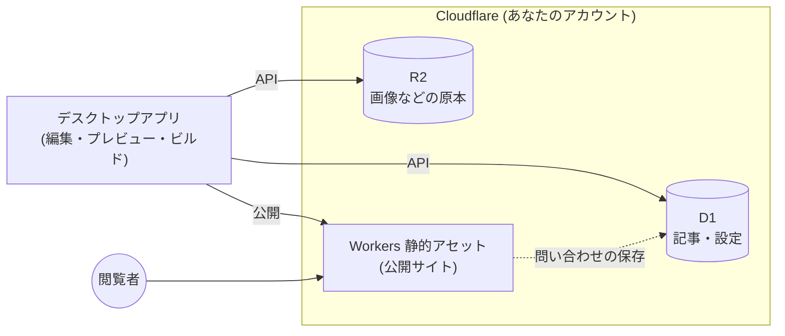

# Zero Web Admin CMS

[English](README.md) | 日本語


公開サイトに管理画面を一切置かない CMS です。略称は ZWA CMS です。

記事の編集はデスクトップアプリで行い、Cloudflare に静的サイトとして公開します。公開サイトにはログイン画面もデータベースへの接続もないため、攻撃される入口がありません。高速で、運用費は Cloudflare の無料プランの範囲に収まる想定です。

> [!NOTE]
> 開発中です。仕様やデータ形式は予告なく変わることがあります。

## 特徴

- **管理画面は手元のアプリだけ**: Windows / macOS / Linux 向けのデスクトップアプリです。サーバーやローカルの開発環境（Node.js など）は不要です。ウィンドウを閉じてもタスクトレイに常駐し、プレビュー用のサーバーを動かし続けます（終了はトレイのメニューから）
- **Cloudflare に全部おまかせ**: 記事は D1、画像などのメディアは R2 に保存し、サイトは Workers の静的アセットとして配信します。必要なリソースはアプリが自動で作成します
- **書きやすいエディタ**: 見たまま編集できるエディタで、保存形式は Markdown です。`# ` や `- ` など Markdown の記法を入力するとその場で書式に変わり、Markdown のテキストを貼り付けても整形されます。画像は貼り付けやドラッグ＆ドロップで挿入できます
- **その場でプレビュー**: 手元でサイトを生成し、ブラウザで確認できます。保存すると自動で更新されます。下書きも表示されます
- **日本語に対応したサイト内検索**: ビルド時に検索用の索引（[Pagefind](https://pagefind.app/)）を作ります。検索はブラウザ内で動くので、サーバー側の処理はありません。不要な場合は「サイト情報」でオフにでき、その分サイトが軽くなります
- **複数サイト対応**: 1つのアプリで複数のサイトを切り替えて管理できます。別の PC から同じサイトに接続することもできます
- **SEO の基本**: sitemap.xml、RSS（feed.xml）、canonical、セキュリティヘッダーを出力します
- **問い合わせフォーム（任意）**: 固定ページにフォームを置けます。送信内容はサイトの D1 に保存され、アプリで読めます。不正な送信は Cloudflare Turnstile で防ぎます

## 仕組み



- アプリは Cloudflare の API を通じて D1 と R2 を直接読み書きします。間に独自のサーバーはありません
- 公開時は、アプリがサイト全体を静的ファイルとして生成し、Workers にアップロードします。2回目以降は変更のあったファイルだけを送ります
- 公開サイトは静的ファイルです。サーバー側で動くのは、問い合わせフォームの送信を受けて D1 に保存する処理だけです（フォームを有効にした場合のみ）。コメント機能はありません

### 対応する環境

ZWA CMS は Cloudflare 専用です。データの保存（D1・R2）、公開（Workers）、問い合わせフォーム（Workers・Turnstile）のすべてが Cloudflare を前提にしています。AWS など他のサービスへの公開には対応しておらず、今後も対応する予定はありません。

コマンドラインツールの `zwa build` で生成したファイルは普通の静的サイトなので、他のサービスに置いて使うことはできます。その場合は自己責任でご利用ください。問い合わせフォームは送信を受け付けられないため動きません。

## 必要なもの

- Cloudflare アカウント（無料プランで利用できます）
  - R2 はアカウントごとに一度、ダッシュボードで有効化しておく必要があります
  - workers.dev のサブドメインが未設定の場合は、ダッシュボードの「Workers & Pages」を一度開いて設定してください
- Cloudflare の **ユーザー API トークン**（下記）

### API トークンの作成

アプリで使うのは **ユーザー API トークン** です。アカウント API トークンではありません。

1. Cloudflare ダッシュボード右上のアイコンから **My Profile → API Tokens** を開きます
2. **Create Token** → **Create Custom Token** を選びます
3. 次の権限を追加します

   | 種別 | 対象 | 権限 |
   |---|---|---|
   | Account | D1 | Edit |
   | Account | Workers R2 Storage | Edit |
   | Account | Workers Scripts | Edit |

   問い合わせフォームを使う場合は、`Account` / `Turnstile` / `Edit` も追加します。後からトークンを編集して追加することもできます（フォームを有効にするときに、足りなければアプリが案内します）

4. **Account Resources** で使用するアカウントを選び、トークンを作成します
5. 表示されたトークンをアプリに貼り付けます

トークンは OS のキーチェーン（Windows の資格情報マネージャー、macOS のキーチェーンなど）に保存されます。設定ファイルに平文で保存されることはありません。

> 将来、ブラウザでログインするだけで接続できる OAuth 方式に対応する予定です。

## 使い方

1. アプリを起動し、API トークンを貼り付けて Cloudflare に接続します
2. 「サイトを追加」で、サイト名とサイト ID を入力します
   - サイト ID は英小文字・数字・ハイフンです。Cloudflare のリソース名（`zwa-<サイトID>` など）に使われ、後から変更できません
   - D1 データベースと R2 バケットが作成されます
3. 記事・固定ページ・カテゴリー・タグ・メディアを編集します（アイキャッチ画像や著者も設定できます。著者は「サイト情報」で登録します）
4. 左下の「プレビュー」で、手元のブラウザでサイトを確認します
5. 「サイトに公開」で Cloudflare に公開します
   - `https://zwa-<サイトID>.<アカウントのサブドメイン>.workers.dev/` で閲覧できます
   - 公開されるのは「公開」状態の記事・固定ページだけです
6. サイトが不要になったら、「サイト情報」→「Cloudflare」→「サイトを削除」で、アプリが作った Cloudflare のリソース（Worker・R2・D1 など）をまとめて削除できます。元に戻せません

### コードの色分け

コードブロックに言語名を書くと（```` ```rust ```` など）、公開サイトとアプリのエディタで色分けされます。サイトではビルド時に色を付けるので、閲覧者のブラウザで JavaScript は動きません。

| 言語 | 書き方 |
|---|---|
| Bash・シェル | `bash` `sh` `shell` `zsh` `console` |
| C / C++ / C# | `c` / `cpp` `c++` / `csharp` `cs` |
| CSS / SCSS | `css` / `scss` |
| diff | `diff` |
| Dockerfile | `dockerfile` `docker` |
| Go | `go` `golang` |
| HTML / XML | `html` / `xml` `svg` |
| INI / TOML | `ini` / `toml` |
| Java / Kotlin | `java` / `kotlin` `kt` |
| JavaScript / TypeScript | `javascript` `js` `jsx` / `typescript` `ts` `tsx` |
| JSON | `json` `jsonc` |
| Lua | `lua` |
| Markdown | `markdown` `md` |
| PHP | `php` |
| PowerShell | `powershell` `ps1` `pwsh` |
| Python | `python` `py` |
| Ruby | `ruby` `rb` |
| Rust | `rust` `rs` |
| SQL | `sql` |
| Swift | `swift` |
| YAML | `yaml` `yml` |

公開サイトでは、ほかにも多くの言語（[bat](https://github.com/sharkdp/bat) と同じ構文定義）に色が付きます。言語名がないもの・知らない言語は色を付けずに表示します。色はテーマの CSS で変えられます。

### デザインの変更

左メニューの「テーマ」で変更します。

- **デザイン設定**: 強調色、ロゴ、favicon、フッターの文言、追加 CSS を設定できます
- **テーマファイル**: 既定のテーマ（HTML テンプレートと CSS）をフォルダに書き出して編集し、フォルダごとアップロードします。テーマはサイトの R2 に保存されるので、どの PC から公開しても同じ見た目になります。作業用フォルダを指定すると、アップロード前にプレビューで確認できます。書き方は書き出したフォルダの README.md（[crates/zwa-site/THEME.md](crates/zwa-site/THEME.md)）を参照してください

### AI アシスタント（任意）

Anthropic の Claude API を使って、記事の作成を手伝います。

- **添削**: 誤字脱字や分かりにくい表現を直した本文を提案します。変更点を差分で確認してから適用でき、適用後も元に戻せます
- **抜粋・タイトル・スラッグ・カテゴリー・タグの案**: 候補を選ぶと入力欄に入ります。各入力欄の ✨ ボタンからも呼び出せます
- **下書きの作成**: テーマやメモから、タイトル・本文・抜粋・タグをまとめて作ります
- **独自のプロンプト**: よく使う指示をボタンとして登録できます。サイトの執筆方針（文体や読者像）もすべての機能に反映されます

使うには、[Claude Console](https://platform.claude.com/) で API キーを作成し、タイトルバーの歯車の「アプリの設定」で登録します。料金は Console で前払いしたクレジットから引かれ、残高がなくなると止まります（自動チャージは購入画面でオフにできます）。

### 問い合わせフォーム（任意）

「サイト情報」→「問い合わせフォーム」で有効にすると、左メニューに「問い合わせ」が出てフォームを作成でき、固定ページの編集画面の「問い合わせフォーム」で表示するページを選べます。フォームはいくつでも作れます。ページの URL は固定ページのスラッグなので、`/contact/` でも `/support/` でも自由です。

- 送信内容はサイトの D1 に保存され、「問い合わせ」の受信一覧で読めます。アプリの起動中は 5 分ごとに確認し、ウィンドウを閉じている間に届いたらデスクトップに通知します。メールでの通知はありません
- 不正な送信は、Cloudflare Turnstile（無料）、ボット向けの見えない入力欄、送信元ページの確認で防ぎます。同じ送信が二重に保存されることもありません
- 有効にするとこのサイト用の Turnstile ウィジェットを作成します。API トークンに Turnstile の権限が必要です
- 送信を受け付けるのは、公開サイトの Worker（`/_zwa/forms/<ID>`）です。Worker が動くのは送信のときだけで、そのほかのページは今まで通り静的に配信されます
- 送信内容には個人情報が含まれます。不要になったものは削除し、必要に応じてサイトにプライバシーポリシーを掲載してください

### Basic 認証（任意）

公開前の確認や、関係者だけに見せたいときは、「サイト情報」→「Basic 認証」でサイト全体にユーザー名とパスワードをかけられます。次の公開から有効になります。

- パスワードはそのまま保存せず、サイトの D1 にソルト付きのハッシュだけを保存します（後から表示はできません。忘れたら設定し直します）
- 有効な間は、すべてのリクエストを Worker が確認します。認証を通った閲覧者の画像や CSS も Workers のリクエスト数に数えられます（無料プランは 1 日 10 万件）

### GitHub 連携（予約投稿）

予約投稿（公開日時を過ぎたら自動で公開）は、サイトを GitHub と連携すると使えます。設定はアプリの「サイト情報」→「GitHub 連携」で行います。仕組みと使うトークンは [docs/github-actions.md](docs/github-actions.md) を参照してください。

### サイトの URL 構成

| ページ | URL |
|---|---|
| トップ（記事一覧） | `/`、`/page/2/` … |
| 記事 | 「サイト情報」の「記事のパーマリンク」で設定（既定は `/posts/{slug}/`。`{slug}` `{id}` `{year}` `{month}` `{day}` が使えます） |
| 固定ページ | `/<親ページのスラッグ>/<スラッグ>/` |
| カテゴリー・タグ | `/category/<スラッグ>/`、`/tag/<スラッグ>/` |
| 著者 | `/author/<スラッグ>/` |
| サイト内検索 | `/search/` |

## 料金について

ZWA CMS 自体は無料です。Cloudflare の利用料金は、あなたのアカウントに対して発生します。一般的なブログや企業サイトの規模であれば、無料プランの範囲に収まる想定です。

- 公開サイトはすべて静的アセットとして配信されます
- 記事データ（D1）とメディア（R2）にアクセスするのは、編集時と公開時のアプリだけです（問い合わせフォームを使う場合は、送信のたびに Worker が D1 を読み書きします）

最新の料金と無料枠は、Cloudflare の公式サイトで確認してください。

## 開発

必要なもの: Node.js、pnpm、Rust、[Tauri v2 の前提ソフトウェア](https://v2.tauri.app/start/prerequisites/)

```sh
pnpm install
pnpm tauri dev      # 開発起動
pnpm tauri build    # インストーラーの作成
```

`.devcontainer/` に開発用コンテナの定義があります。

| ディレクトリ | 内容 |
|---|---|
| `src/` | 管理画面（React + TypeScript） |
| `src-tauri/` | デスクトップアプリ本体（Rust / Tauri）。Cloudflare API、プレビュー、公開 |
| `crates/zwa-site/` | サイト生成（Rust）。テンプレートは `crates/zwa-site/theme/` |
| `crates/zwa-core/` | Cloudflare（D1・R2・Workers）とのやり取りと公開処理。アプリと CLI で共通 |
| `crates/zwa-cli/` | コマンドラインツール `zwa`（GitHub Actions 向け） |
| `migrations/` | D1 のスキーマ |

GitHub 連携で使うサイト用のリポジトリのテンプレート（公開のワークフロー）は、別のリポジトリ [zwa-cms-site-template](https://github.com/imo-tikuwa/zwa-cms-site-template) です。

## アイコンについて

アイコンは禅の **円相**（一筆で描く円）です。製品名の「Zero」と、「公開サイト側には何も置かない」という考え方を表しています。

## ライセンス

[MIT](LICENSE)

アプリの画面には Noto Sans JP（[SIL Open Font License 1.1](https://openfontlicense.org/)）を同梱しています。
