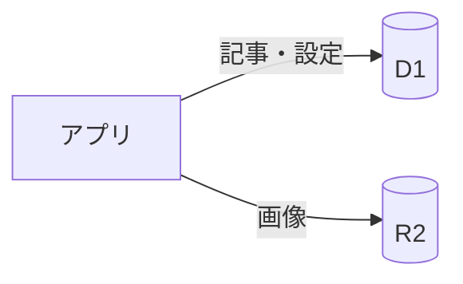
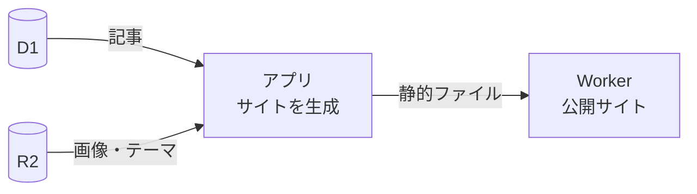
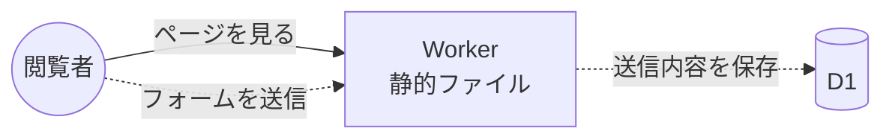

# 仕組み

ZWA CMS の登場人物は、手元のアプリと、あなたの Cloudflare アカウントにある 3 つ（D1・R2・Worker）だけです。間に独自のサーバーはありません。

| 置き場所 | 中身 |
|---|---|
| D1（データベース） | 記事・固定ページ・カテゴリー・タグ・設定・受信した問い合わせ |
| R2（ファイル置き場） | 画像の原本、アップロードしたテーマ |
| Worker（公開サイト） | 生成した HTML・画像・CSS などの静的ファイル |

## 編集するとき

アプリは Cloudflare の API で D1 と R2 を直接読み書きします。保存した時点では、公開サイトは変わりません。

## 公開するとき

- 「サイトに公開」で、アプリが D1 と R2 から読み込んでサイト全体を生成し、Worker にアップロードします
- 2 回目からは、変わったファイルだけを送ります
- 予約投稿では、同じ処理を GitHub Actions が行います（[GitHub 連携](github-actions.md)）

## 閲覧されるとき

- ページは静的ファイルとして返すだけで、D1 には触れません
- 点線は問い合わせフォームを有効にしたときだけです。Worker が送信を受けて D1 に保存します（[問い合わせフォーム](forms.md)）
- Basic 認証を有効にしたときは、すべてのリクエストを Worker が確かめてから返します（[Basic 認証](basic-auth.md)）

## 公開サイトにないもの

ログイン画面、管理画面、コメント、サーバー側で記事を組み立てる処理はありません。攻撃される入口になりやすい部分を、最初から置いていません。

画像は R2 から直接配信せず、公開のときに必要なものを静的ファイルに含めます（幅の広い JPEG・PNG はこのとき縮小します）。
