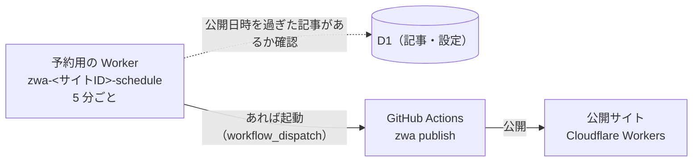

# GitHub 連携（予約投稿）

サイトを GitHub と連携すると、**予約投稿**が使えるようになります。公開日時を未来にした記事を、その日時を過ぎたら自動でサイトに公開します。

連携しなくてもサイトは公開できます。その場合、公開日時に未来の日時は選べません。テーマは連携の有無に関係なく、アプリの「テーマ」画面で管理します（サイトの R2 に保存されます）。

設定はアプリの「サイト情報」→「GitHub 連携」で行います。GitHub の画面で行うのは、テンプレートからのリポジトリの作成と、トークンの作成の 2 つだけです。どちらもアプリのボタンから、入力済みのページが開きます。

## 仕組み



- 予約用の Worker は、前回の公開の後に公開日時を過ぎた記事があるかを D1 で確かめ、あれば GitHub の API でワークフローを起動します
- ワークフローは `zwa publish`（アプリの「サイトに公開」と同じ処理）でサイトを公開します
- 一度も公開していないサイトでは、予約用の Worker は何もしません（予約投稿の仕組みが勝手にサイトを初公開しないように）。連携は公開の前でもできます

- 予約用の Worker は Cloudflare の Cron Trigger で動きます。無料プランでは Cron Trigger はアカウントあたり 5 つまでなので、予約投稿を使えるのは 5 サイトまでです
- GitHub Actions は公開が必要なときだけ動くので、Actions の時間はほとんど消費しません
- 予約の時刻から、公開されるまで数分（確認の間隔 5 分 ＋ 公開にかかる時間）遅れます
- 公開は同時に 1 つだけです。GitHub Actions が公開している間にアプリで「サイトに公開」を押すと、終わってからもう一度押すよう案内が出ます。逆に、アプリが公開している間はワークフローが待ちます

## 連携の手順

1. **リポジトリを作る**: アプリの「テンプレートからリポジトリを作る」で、テンプレートリポジトリ（[imo-tikuwa/zwa-cms-site-template](https://github.com/imo-tikuwa/zwa-cms-site-template)）からの作成ページが開きます。リポジトリ名（既定 `zwa-<サイトID>`）とプライベートが入力済みです
2. **トークンを作る**: アプリの「トークンを作る」で、名前・期限・権限が入力済みの作成ページが開きます。Repository access で、作ったリポジトリだけを選びます
3. **連携する**: トークンをアプリに貼り付けて「連携する」を押すと、アプリが次を行います
   - GitHub Actions 用の Cloudflare トークンを作り、リポジトリの Actions のシークレットに設定する
   - 予約用の Worker を作り、トークンをそのシークレットとして保存する。Cron Trigger を設定する

## 使うトークン

| トークン | 作る場所 | 権限 | 置き場所 |
|---|---|---|---|
| GitHub のトークン | GitHub（fine-grained token、サイトごとに 1 つ。そのサイトのリポジトリだけ、期限なし） | Actions / Secrets の Read and write | 予約用の Worker のシークレット（この PC には保存しない） |
| GitHub Actions 用 | アプリが Cloudflare に作る（アカウント API トークン） | D1 / Workers R2 Storage / Workers Scripts の Edit（問い合わせフォームが有効なら Turnstile も） | リポジトリの Actions のシークレット |

- GitHub のトークンでできるのは、そのリポジトリのワークフローの起動と、シークレットの上書きだけです。ワークフローの書き換えやシークレットの読み出しはできないため、漏れても Cloudflare のトークンは取り出せません
- GitHub のトークンは期限なしにします。期限が切れると予約投稿が止まります（作り直したときは、連携を解除してからもう一度連携します）
- GitHub Actions 用の Cloudflare トークンをアプリが作るため、アプリで使っているユーザー API トークンに `Account · Account API Tokens · Edit` の権限が必要です

## リポジトリの中身

```
.github/workflows/zwa-publish.yml   公開のワークフロー（手動でも実行できます）
README.md
```

Actions のシークレットは次の 3 つで、アプリが設定します。

| シークレット | 内容 |
|---|---|
| `CLOUDFLARE_API_TOKEN` | GitHub Actions 用の Cloudflare トークン |
| `CLOUDFLARE_ACCOUNT_ID` | Cloudflare のアカウント ID |
| `ZWA_SITE_ID` | サイト ID |

- 記事・画像・テーマはリポジトリには入りません（D1・R2 にあります）
- ワークフローは手を加えても構いません。ただしファイル名（`zwa-publish.yml`）は変えないでください（予約用の Worker がこの名前で起動します）
- 自分用に手を加えたリポジトリをテンプレートにして、次のサイトに使うこともできます。リポジトリの Settings → General で「Template repository」にチェックを入れ、そのテンプレートから作ったリポジトリを連携します

## 連携を解除する

「GitHub 連携」の「連携を解除」で、予約用の Worker と GitHub Actions 用の Cloudflare トークンを削除します。

- GitHub のリポジトリとトークンは消えません。不要なら GitHub で削除してください
- 予約中の記事は自動では載らなくなり、日時を過ぎた後の「サイトに公開」で載ります

## コマンドラインツール `zwa`

ワークフローの中で使っているコマンドです。手元でも使えます。

```text
zwa build      --site <サイトID> [--out <出力先>] [--drafts]   サイトを生成してフォルダに出力する
zwa publish    --site <サイトID>                              生成して Cloudflare に公開する
zwa theme push --site <サイトID> --dir <テーマのフォルダ>       テーマを R2 に保存する（アプリの「フォルダからアップロード」と同じ）
```

環境変数 `CLOUDFLARE_API_TOKEN`（D1 / Workers R2 Storage / Workers Scripts の Edit 権限）と `CLOUDFLARE_ACCOUNT_ID` が必要です。手元で試す場合は、Rust をインストールして `cargo install --path crates/zwa-cli` でインストールできます。
