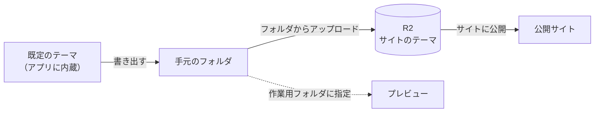

# テーマ

サイトの見た目は、左メニューの「テーマ」で変えます。変え方は 2 段階あります。

| | デザイン設定 | テーマファイル |
|---|---|---|
| できること | 強調色、ロゴ、ファビコン、ライト・ダーク、フッターの文言、追加 CSS | HTML テンプレートと CSS を書き換えて、自由に変える |
| 必要な知識 | なし | HTML・CSS と、テンプレートの書き方 |
| 保存場所 | D1（サイトの設定） | R2（`theme/` の下） |

どちらもサイトに保存されるので、どの PC から公開しても同じ見た目になります。反映されるのは次の「サイトに公開」からです。

## デザイン設定

「テーマ」画面の上半分です。入力して保存するだけで、既定のテーマにもテーマファイルで作ったテーマにも効きます。

## テーマファイル

既定のテーマを書き出して、手元で編集し、アップロードします。

1. **既定のテーマを書き出す**: フォルダを選ぶと、テンプレートと CSS と、書き方の説明（README.md）が書き出されます
2. **作業用フォルダに指定する（任意）**: プレビューが、そのフォルダのテーマで表示されるようになります。編集しながら確認できます。この設定はこの PC だけのもので、公開には使われません
3. **フォルダからアップロード**: フォルダの中身がサイトの R2 に保存されます。公開にはこれが使われます

「既定のテーマに戻す」で、アップロードしたテーマを R2 から削除できます（手元のフォルダとデザイン設定は残ります）。

- 置かなかったファイルには、既定のテーマのものが使われます。変えたいファイルだけ置いても構いません
- テーマをアップロードした後は、アプリの更新で既定のテーマが改善されても、アップロードしたファイルには反映されません
- テンプレートの書き方と使える変数は [テーマの作り方](../crates/zwa-site/THEME.md) を参照してください
